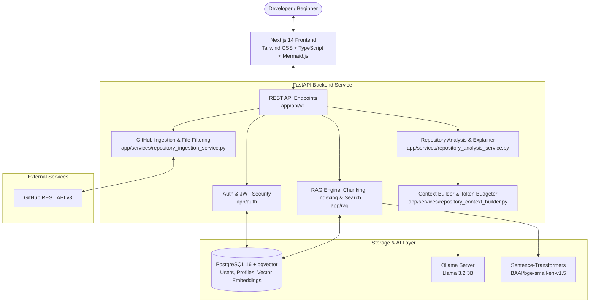
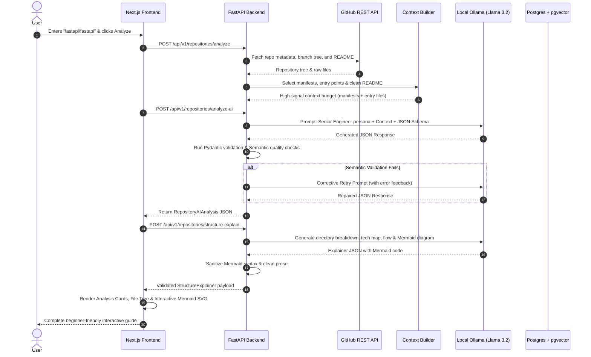

# OpenSource Copilot — How It Is Built & What Each Part Does

A complete, beginner-friendly architectural walkthrough of **OpenSource Copilot**, explaining how the entire application is structured, how the pieces fit together, and what each subsystem does.

---

## 1. What is OpenSource Copilot?

When developers or beginners open an unfamiliar open-source GitHub repository, they often face thousands of files, unfamiliar frameworks, and sparse documentation.

**OpenSource Copilot** acts as an AI pair programmer and onboarding mentor:
1. You provide a GitHub repository URL (e.g., `fastapi/fastapi` or `Effect-TS/effect`).
2. It fetches and analyzes the code, tree, documentation, and open issues.
3. It explains the project in plain English, generates interactive architecture diagrams, maps entry points, and matches issues to your skills.

---

## 2. High-Level Architecture

---

## 3. The 8 Core Subsystems: What Part Does What

### Part 1: Frontend (User Interface)
*Path: `frontend/`*
*Tech: Next.js 14 (App Router), React 18, TypeScript, Tailwind CSS, Mermaid.js*

| Component / File | Purpose |
|---|---|
| **`app/page.tsx`** | Main application dashboard where users enter repository URLs and switch between analysis tabs. |
| **`components/repository/structure-explainer.tsx`** | Renders the high-level architecture, directory breakdown, key files, and the beginner learning path ("Where Should I Start?"). |
| **`components/ui/mermaid-diagram.tsx`** | Client-side Mermaid v12 rendering engine with automatic syntax sanitization, retry recovery, and zoom/pan. |
| **`components/repository/repository-tree.tsx`** | Interactive, collapsible file tree browser with file classification badges. |
| **`context/auth-context.tsx`** | Manages logged-in user state, JWT token storage, and login/logout lifecycles. |

---

### Part 2: Backend REST API & Routing
*Path: `backend/app/api/`*
*Tech: FastAPI, Uvicorn, Pydantic*

| Endpoint Group | Primary File | Purpose |
|---|---|---|
| **`/api/v1/repositories/*`** | `endpoints/repositories.py` | Ingests repositories, triggers AI analysis, structure explainer, and issue fetching. |
| **`/api/v1/auth/*`** | `endpoints/auth.py` | User registration, login, JWT token generation, and current user retrieval. |
| **`/api/v1/chat/*`** | `endpoints/chat.py` | Interactive Q&A chat endpoint grounded by the RAG retrieval pipeline. |
| **`/api/v1/profiles/*`** | `endpoints/profiles.py` | Developer skill profiles (languages, experience, preferred issue tags). |

---

### Part 3: Authentication & Security
*Path: `backend/app/auth/`*
*Tech: PyJWT, Passlib (bcrypt)*

| Module | Purpose |
|---|---|
| **`security.py`** | Hashes passwords with bcrypt salts, signs and decodes HS256 JWT tokens, and uses constant-time comparison to prevent timing attacks. |
| **`service.py`** | Business logic for registering users, authenticating credentials, and attaching default profiles. |

---

### Part 4: GitHub Integration & File Classification
*Path: `backend/app/services/`*
*Tech: HTTPX (Async), GitHub REST API v3*

| Service | File | Purpose |
|---|---|---|
| **GitHub Service** | `github_service.py` | Asynchronously queries GitHub API for repository metadata, branch trees, README contents, commits, and open issues. |
| **File Filter** | `repository_file_filter.py` | Automatically categorizes repository files into manifests (`package.json`, `pyproject.toml`), entry points (`main.py`, `index.ts`), source code, documentation, and excludes noisy files (`node_modules/`, binaries, build output). |
| **Ingestion Service** | `repository_ingestion_service.py` | Orchestrates repository ingestion, tree flattening, and file content caching. |

---

### Part 5: Context Selection & Noise Reduction Engine
*Path: `backend/app/services/repository_context_builder.py`*

Local AI models have finite context windows. Dumping massive, irrelevant JSON configs causes hallucinations. This service acts as the "smart filter":
- **Priority Hierarchy**: Gathers manifests $\rightarrow$ entry points $\rightarrow$ core source files $\rightarrow$ general config.
- **Linter Deprioritization**: Pushes `.oxlintrc.json`, `.prettierrc`, and lockfiles below actual source code so real application logic is never crowded out.
- **Markdown Cleaner (`clean_markdown_for_llm_context`)**: Strips shields.io badges, HTML tables, and CI links from READMEs so the model doesn't mistake badge text for project description.

---

### Part 6: AI Analysis, Structure Explainer & Safeguards
*Path: `backend/app/services/` & `backend/app/prompts/`*
*Tech: Ollama (Llama 3.2 3B), Pydantic Schemas*

| Service / Prompt | Location | What It Does |
|---|---|---|
| **Repository Analysis** | `repository_analysis_service.py` `prompts/repository_analysis.py` | Generates Project Summary, Purpose & Target Audience, Architecture, Beginner Explanation, and Confidence Assessment. |
| **Structure Explainer** | `structure_explainer_service.py` `prompts/structure_explainer.py` | Produces directory breakdowns, file importance maps, execution data flow, and Mermaid diagram source code. |
| **Structured Output** | `json_mode=True` | Enforces rigid JSON format directly from the LLM matching Pydantic schemas. |
| **Semantic Quality Checks** | In analysis services | Detects truncated sentences, badge link leakage (`[![`), non-English hallucinations, and cross-field repetition. |
| **Corrective Retry** | Bounded retry | If LLM output fails validation, automatically asks the model once to fix the specific error using validation feedback. |
| **Mermaid Normalizer** | `clean_mermaid_diagram()` | Cleans up node labels and quotes special characters to prevent diagram rendering crashes. |

---

### Part 7: RAG (Retrieval-Augmented Generation) Pipeline
*Path: `backend/app/rag/`*
*Tech: Sentence-Transformers (`BAAI/bge-small-en-v1.5`), pgvector*

Enables users to ask specific questions about files, functions, or concepts in the repository:
1. **Document Loader** (`document_loader.py`): Ingests source code files into document objects.
2. **Chunker** (`chunker.py`): Splits code files into chunks while preserving code function/class boundaries.
3. **Indexer** (`indexer.py`): Generates 384-dimensional dense vector embeddings using a lightweight local CPU model and indexes them in PostgreSQL.
4. **Vector Retriever** (`vector_retriever.py`): Performs cosine similarity search against embedded repository chunks.
5. **Keyword Retriever** (`retriever.py`): BM25-style keyword fallback if semantic vector search returns no results.

---

### Part 8: Database & Vector Storage
*Path: `backend/docker-compose.yml` & `backend/app/models/`*
*Tech: PostgreSQL 16 + pgvector extension, SQLAlchemy 2.0 (asyncpg)*

- **Relational Tables**: Stores user accounts, hashed credentials, developer profiles, and analysis cache.
- **Vector Tables**: Uses the `pgvector` extension to store chunk embeddings directly alongside relational data in the same PostgreSQL database, avoiding external vector SaaS dependencies.

---

## 4. End-to-End Workflow: What Happens When You Analyze a Repo

---

## 5. Key Design Principles

1. **Local-First & Private**:
   All AI inference (Ollama Llama 3.2 3B) and embedding generation (`bge-small-en-v1.5`) run locally without external paid API keys or cloud dependencies.
2. **Context Budgeting Over "Dump Everything"**:
   Rather than overwhelming the model with thousands of lines of config or badges, `RepositoryContextBuilder` selects high-value entry files and cleans documentation.
3. **Defensive AI Engineering**:
   Combines JSON mode, Pydantic type validation, semantic prose filters (detecting badge links, unfinished thoughts, or repetition), and a bounded corrective retry to ensure consistent, production-ready responses.
4. **Unified Storage**:
   PostgreSQL with `pgvector` provides a single database for both traditional app data (users, auth, profiles) and vector embeddings (code chunks).
